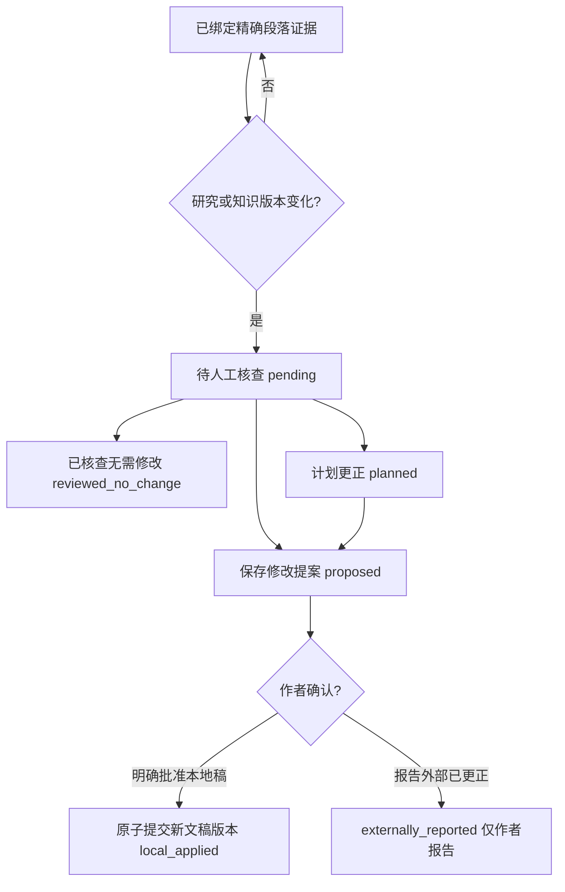

# V26 技术契约：Paragraph Evidence & Precise Corrections

## 产品边界

1. 追踪的是本系统维护的本地 `content_reference` + `article_document`，不是已发表媒体平台正文。
2. `paragraph_claim` 是作者对“某句引用某项一手记录”的声明，不是独立事实核验。
3. 研究变化产生的是“潜在受影响原句”，不可推断语句已经失实，也不可自动更正平台文章。
4. 主稿、微信稿和知乎稿分别拥有独立 `content_reference.id`、文章修订和精确锚点。旧 Brief、知识版本与证据记录不可逆向篡改。

## 持久化表

| 表 | 主键 | 作用 |
|---|---|---|
| `article_documents` | `reference_id` | 当前本地文稿修订号 |
| `article_document_revisions` | `id`; UNIQUE(reference_id, revision) | 不可变的每一版段落数组；`p_...` 稳定段落 ID |
| `paragraph_claims` | `id` | 文章/段落/原句/知识修订/研究版本/证据 ID 快照 |
| `precision_corrections` | `id`; UNIQUE(claim_id, trigger_knowledge_revision, trigger_case_version) | 一次知识或研究版本变化生成的人工核查任务 |
| `precision_audit` | `id` | 添加、修改、判断的操作留痕 |

### 版本、锚点与幂等

- `POST /api/precision/documents` 的 `expectedRevision` 必须等于当前修订，否则返回 HTTP 409。每次编辑追加新版本，不原地更新旧版。
- 一个段落 `id` 不可重复。精确引文必须出现在该段的当前正文中。若后续变化，状态为 `quote_changed`；段落删除则 `paragraph_missing`，不会拿相似文字自动匹配。
- `evidenceIds` 必须来自关联知识卡**最新已发布修订**中保存的一手记录。不能注入其他研究案例的证据。
- `POST /api/precision/corrections/scan` 只对**已创建精确锚点**的内容，根据当前知识修订/研究版本与引用快照的差异创建核查任务。相同触发版本通过 SQLite UNIQUE 约束确保多次扫描幂等。
- 若研究再次发生变化，旧任务不允许按过时事实基线执行决策（HTTP 409），必须处理新版本的任务。

### 更正状态机

- `proposed` 只是建议内容，不会覆盖正文。
- `apply_local` 同事务插入文章修订、更新更正任务、追加审计记录；版本冲突/失效锚点禁止应用。
- `report_external` 仅对 `reported_published` 且已填外部 URL 的引用允许记录；系统无法验证平台实际上已更改。
- `plan` 是开放任务，不计入已完成。
- 历史引用锚点永不自动跟着改写后的文本迁移，需由作者重新绑定。

## HTTP 端点

| Method | Path | 说明 |
|---|---|---|
| GET | `/api/precision` | 返回引用、文档、锚点、任务及状态统计 |
| POST | `/api/precision/documents` | `{referenceId,expectedRevision,paragraphs:[{id?,text}]}` 新建/修订本地文章 |
| GET | `/api/precision/documents/:referenceId` | 当前文稿 |
| GET | `/api/precision/documents/:referenceId/history` | 不可变历史文稿 |
| POST | `/api/precision/claims` | `{referenceId,paragraphId,quote,evidenceIds}` 创建精确证据引用 |
| POST | `/api/precision/corrections/scan` | 扫描知识/研究版本变化并幂等创建任务 |
| POST | `/api/precision/corrections/:taskId/propose` | `{expectedDocumentRevision,proposedText,reason}` 暂存更正建议 |
| POST | `/api/precision/corrections/:taskId/decide` | `{action,expectedDocumentRevision,note}` 人工处理，`action` 为 `apply_local/no_change/plan/report_external` |

错误采用 JSON `{error:"..."}`。400 校验，404 不存在，409 版本/状态冲突，403 来源不允许。HTTP 服务监听 `127.0.0.1`，没有身份系统，不能公网暴露。

## 测试已覆盖

- 旧版正文不可变、版本冲突与重复 ID 校验。
- 精确字符串引文及关联研究证据的作用域校验。
- 研究更新只创建一份幂等任务；再更新时旧任务不能误标处理完成。
- 建议保存不修改正文，审批后原子创建新修订。
- 导出稿无法伪称外部更正，公众号和知乎引用各自独立。
- 旧锚点断裂/段落删除时不会自动漂移到其他位置。
- 实际 HTTP 全链路及浏览器 UI 与 HTTP API 桥接。

## 关键剩余风险

- 此版本的文章正文不是从真实 V21 编辑器自动同步而来。V21 使用 HTML/JS 模拟编辑器，尚未实现可靠的共享结构化文稿状态所有者。**不能声称上线后可以自动定位任意旧文章段落。**
- 精确字符串锚点还不支持复杂富文本编辑（节点移动、复制粘贴、表格、跨块引文、代码片段）的鲁棒映射，必须增加 editor node id 和人工重新锚定流程。
- 作者采录的一手记录存在真实性、授权、范围偏差，需要实际核实；没有接入公众号/知乎写入，更正均为本地或作者自行报告。
