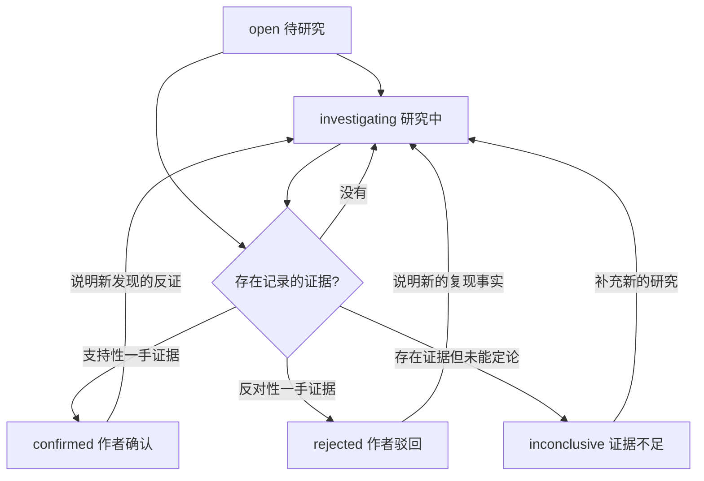

# V24 · 问题验证领域模型与 API 契约

## 意图与边界

构建作者可追溯的「问题假设 → 复现或用户观察 → 反证 → 作者结论 → 原创内容 Brief」闭环。**系统只能验证数据约束，不能自动证明外部世界事实。** AI 识别出问题信号意味着“值得观察”，不是“需求已被验证”。

## 数据库

- `verification_cases`：记录建档时的 `event_snapshot`，即使后续精选被撤选，也不丢失历史出处；一条 `event_id` 对应一个档案；`version` 是乐观并发版本号；`status` 允许 `open / investigating / confirmed / rejected / inconclusive`。
- `verification_evidence`：不可变观察记录，保留 `kind/result/observation/ref_url/observed_at/created_at`。记录不可直接编辑或删除，以免悄悄改写过去的判断；若有笔误，应重新打开档案并添加更正性证据。
- `verification_history`：创建、修改、添证、作结、重新打开的不可删操作历史。
- `briefs.snapshot.verification`：创建文章时保存当前作者假设、结论、证据及快照时间，并随 Brief 保持不变。

## 状态转移

- 锁定状态下不得编辑计划或追加证据；必须附理由 `reopen` 并保留审计历史。
- `confirmed` 要求至少一条**支持性** `reproduction / user_interview / usage_observation`；`rejected` 要求至少一条**反对性**同类记录。`document_review` 不可以独立确认需求。
- `reproduction` 只能证明作者**声称**复现了特定技术现象，不能证明真实用户有需求；仅对支持性的 `user_interview / usage_observation` 才将 `validatedUserProblem=true`，并且始终保留 `verificationScope='author-recorded; independent verification not performed'`。
- `inconclusive` 至少存在一条记录。以上是软件级逻辑校验，不包含录音、访谈同意书和证据内容真实性鉴定。

## 编辑优先级

保留 V23 原始 `score`，另外计算 `editorialPriority`，不覆盖原始打分：

- 作者确认且含用户访谈 / 使用观察 → `+16`；
- 作者确认且支持性技术复现 → `+7`；
- 作者确认但非上述 → `+2`；
- 作者驳回 → `-26`；
- 证据不足 → `-9`；
- 尚未立项或研究中 → `0`。

排序先按 `editorialPriority`，再以原始 `score` 和标题稳定排序。**这些是编辑流程初值，不是统计推断或模型信心分数**。每项必须带 `editorialNote` 解释来源。

## 可靠性与异常处理

- 数据写入使用单进程 SQLite 同步事务；证据与状态更新在同一事务完成。
- 前端提交携带版本号，旧版本写入返回 409；界面刷新后人工重新确认，避免覆盖。
- 内容长度、受限枚举、URL scheme、观察日期基本合法性均在服务端验证；长度超过限制或缺少依据返回 400。
- 重复创建档案返回已有档案，避免用户重试时生成多个案例。
- 当精选或来源撤选、移除导致活动事件消失，`event_snapshot` 可用于阅读历史研究与生成标记了“撤选”的 Brief；不得将这类记录展示成当前有效的精选。
- Brief 冻结研究证据：重新打开或改判不会修改旧的 Brief 版本；将来可以增加“研究结论已变化”警告，不允许后台静默变更稿件。
- 内网本地开发仍缺少账户鉴权与数据加密，禁止公网部署。

## 未来需人为验证的问题

1. 一条匿名用户访谈是否足以提高编辑优先级？权重需真实创作者研究校正。
2. 是否需要面向多研究员的证据审查、独立复核、撤销与合规审计？
3. 采访同意、隐私脱敏、证据附件应如何安全保存？
4. 如何识别旧 Brief 引用的研究结论已经被新研究推翻？
